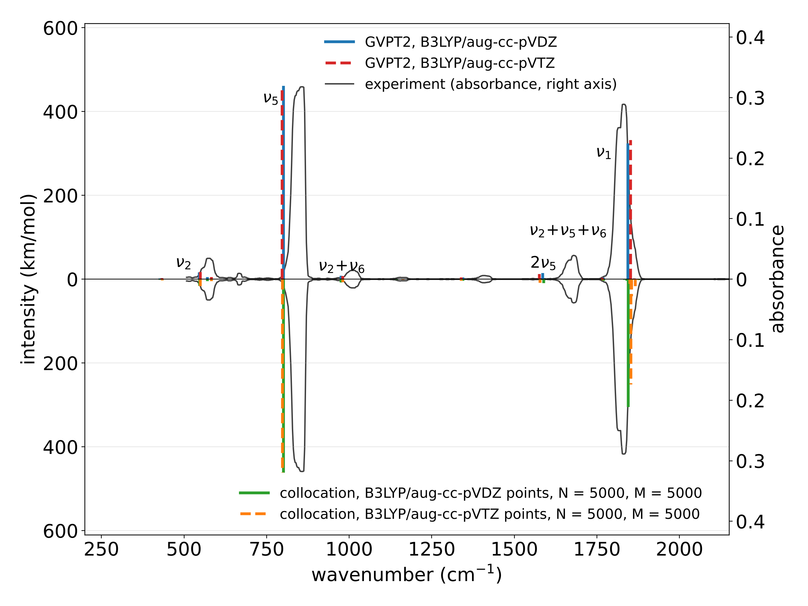

# Example session: the IR spectrum of Cl2CO from DFT points with the `rectangular-collocation-vib` skill

This file shows how a user works with the skill (`skill/rectangular-collocation-vib/SKILL.md`) to get a vibrational
spectrum: what the user asks, and what Claude answers and does at each step.

**How this example was made.** It is a condensed version of the real Cl2CO work in this repository
(October-November 2026). The user requests are written as a new user would phrase them. Claude's replies are
shortened, but every setting, command and number in them comes from the scripts and result files in `cl2co/`; the
source file is named under each table. Waiting time, status messages and tool calls are left out.

---

### User

> I would like to compute the spectrum of Cl2CO using DFT.

### Claude

I'll compute the vibrational levels and the IR spectrum of Cl2CO by rectangular collocation directly on DFT points:
energy, gradient and dipole at every point, no fitted potential.

This machine has 2 cores, and one B3LYP/aug-cc-pVDZ energy + gradient + dipole of Cl2CO takes about 10 s here. A
production run needs about 6000 points (collocation + validation), so about 17 h here, or about 1 h on a 48-core
workstation. The points are independent, so they can be computed anywhere and in pieces; every point is cached as
soon as it is done.

**Please give me:**
1. Functional and basis set.
2. Isotopologue.
3. Number of levels (`nev`).
4. Basis size N and the energy limit of the point region, Vmax.

**Defaults I'll use unless you say otherwise:**
- Coordinates: Eckart-frame dimensionless normal coordinates. Basis: Gaussians. Kinetic energy: exact, by 5-point
  Cartesian finite differences, h = 10⁻³ bohr.
- Potential-gradient rows in addition to the energy rows (the DFT gradient costs little more than the energy).
- The dipole is saved at every point, so the intensities need no extra DFT.
- A fixed set of validation points, never used in the fit, for the residual check.
- PySCF: grid level 3, `conv_tol` = 10⁻¹⁰, gradients with grid response, no reorientation (`symmetry = False`).

This repository already has a neural-network PES for Cl2CO (`cl2co/pes.py`). I'd use it only to set up the
calculation: its normal coordinates, its basis centres, and a cheap pre-screening of the points, so that no DFT is
spent on points above Vmax. All energies, gradients and dipoles in the collocation come from DFT. (Without such a
PES, the skill uses the DFT Hessian for the coordinates and a polynomial surrogate for the pre-screening.)

---

### User

> B3LYP/aug-cc-pVDZ, ³⁵Cl₂¹²C¹⁶O, 100 levels, N = 5000, Vmax = 5000 cm⁻¹. Go ahead.

### Claude

Started. Setup:

| Item | Setting |
|---|---|
| DFT | B3LYP/aug-cc-pVDZ, PySCF, grid level 3, `conv_tol` 10⁻¹⁰, `conv_tol_grad` 10⁻⁶, gradients with grid response |
| Reference energy | B3LYP/aug-cc-pVDZ minimum, E₀ = −1033.7840144379 Eh |
| Coordinates | Eckart-frame dimensionless normal coordinates of the NN-PES minimum |
| Basis | N = 5000 Gaussians, centres from the R2 sequence with V ≤ Ec = 1150 cm⁻¹, widths tuned earlier on the NN PES |
| Collocation points | R2 sequence, V ≤ 5000 cm⁻¹; M = 2500 first, then 5000 |
| Rows | energy rows + gradient rows weighted by (1 − V/Vmax)³ |
| Validation | 1000 points from a separate stretch of the R2 sequence (from index 10,000,000) |
| Eigenpairs | 100, shift-invert around 2250 cm⁻¹ |

B3LYP/aug-cc-pVDZ harmonic wavenumbers: ν3 297.1, ν6 432.9, ν2 556.7, ν4 579.2, ν5 818.7, ν1 1862.3 cm⁻¹
(mode order by frequency: ν3, ν6, ν2, ν4, ν5, ν1).

Commands (`cl2co/workflow_dft_collocation.sh`, steps 1-3):
```
NT=2 python3 colloc_dft.py aug-cc-pvdz adz          # DFT at the points (resumable cache)
python3 rebuild_npz.py adz aug-cc-pvdz               # merge the cache
OMP_NUM_THREADS=8 python3 run_dft.py adz 5000 5000 3 "2500,5000" dft_adz_M5000
```

*(after the points are done)*

The collocation on the B3LYP points is done:

| | M = 2500 | M = 5000 |
|---|---|---|
| ZPE | 2264.42 | 2264.42 |
| ν3 | 294.76 | 294.61 |
| ν6 | 429.30 | 429.34 |
| ν2 | 549.30 | 549.44 |
| ν4 | 574.10 | 573.74 |
| 2ν3 | 588.58 | 588.90 |
| ν3 + ν6 | 722.50 | 723.19 |
| ν5 | 803.56 | 803.44 |
| validation residual, median of 100 levels | 116.3 | 53.1 |
| validation residual, max of 100 levels | 287.2 | 154.1 |

cm⁻¹; levels above the ZPE. Source: `cl2co/results/dft_adz_M5000.json`.

From M = 2500 to 5000 the lowest levels move by at most 0.7 cm⁻¹, and the residuals halve. There are no reference
levels for the DFT surface, so the validation residual is the accuracy check.

---

### User

> The widths were tuned on the NN PES. Re-tune them on the DFT points, minimizing the maximum validation residual,
> with 5% and then 1% steps.

### Claude

Done. Procedure (`cl2co/tune_dft_max.py`). Every trial is the production run itself (N = 5000, M = 5000, gradient rows
with p = 3, Vmax = 5000 cm⁻¹, Ec = 1150 cm⁻¹). The objective J is the largest unweighted validation residual over the
100 levels, on the 1000 DFT validation points.
1. A common width β₀ for all modes: J = 537.3 (0.80), 307.5 (0.85), 173.5 (0.90), **165.1 (0.95)**, 248.2 (1.00)
   → β₀ = 0.95.
2. Coordinate descent over the six modes, each width × 0.95 / × 1.05, accepted if J decreases, until a sweep
   changes nothing.
3. The same with × 0.99 / × 1.01.

Each trial takes about 6.5 min on one thread.

**Result:** widths (ν3, ν6, ν2, ν4, ν5, ν1) = 0.8309, 0.9288, 0.9776, 0.9875, 1.0684, 0.9499
(`cl2co/best_widths_dft_adz_max.json`).

| M = 5000 | PES widths | DFT-tuned widths |
|---|---|---|
| max validation residual (J) | 154.1 | 108.8 |
| median validation residual | 53.1 | 46.0 |
| ZPE | 2264.42 | 2264.45 |
| ν5 | 803.44 | 803.68 |

cm⁻¹. Sources: `cl2co/results/dft_adz_M5000.json`, `cl2co/results/dftw_dft_adz_M5000.json`,
`cl2co/results/tune_dft_adz_max.log`.

The residuals drop by 13% (median) and 29% (maximum), but the levels barely move: the fundamentals change by at most 0.24 cm⁻¹ (ν5). I'll
use the DFT-tuned widths from here on.

---

### User

> Now compute the IR spectrum and compare it with GVPT2 at the same level of theory.

### Claude

**Dipole surface:** a degree-4 polynomial fitted to the B3LYP dipoles at the 5000 collocation points
(`fit_dip.py adz 4`). RMS error on the 1000 validation points: 1.3 × 10⁻⁵, 9.4 × 10⁻⁵ and 5.0 × 10⁻⁵ au for the
three components, the same as on the fit points.

**Intensities:** transition dipoles from the collocation wavefunctions, integrated on a dense grid with the Eckart
volume element (`ir6.py`).

**GVPT2:** my numerical GVPT2 on a quartic force field and dipole surface from 135 B3LYP/aug-cc-pVDZ calculations at
the B3LYP minimum (`vp_dft.py`, `vp_fit.py`, `vp2.py`).

| Band | Collocation E | Collocation A | GVPT2 E | GVPT2 A |
|---|---|---|---|---|
| ν3 | 294.55 | 0.23 | 294.44 | 0.23 |
| ν6 | 429.25 | 1.78 | 429.17 | 1.80 |
| ν2 | 549.43 | 16.22 | 549.31 | 16.27 |
| ν4 | 573.82 | 4.57 | 573.73 | 4.58 |
| ν5 | 803.68 | 462.10 | 803.15 | 461.54 |
| 2ν5 | 1591.27 | 9.83 | 1588.35 | 14.60 |
| ν1 | 1847.71 | 305.17 | 1846.41 | 323.82 |
| ZPE | 2264.45 | | 2264.36 | |

E in cm⁻¹ above the ZPE, A in km/mol. Sources: `cl2co/results/ir_dftw_dft_adz_M5000_dipfit_adz_d4.json`,
`cl2co/vpt2_adz.json`.

The fundamentals agree within 0.6 cm⁻¹ (ν1: 1.3 cm⁻¹), and the intensities of ν2-ν6 within about 1%. The larger
differences are for 2ν5 (3 cm⁻¹, 9.8 vs 14.6 km/mol) and the ν1 intensity (305 vs 324 km/mol).

**Reminder: ν1 is in resonance with ν2 + ν5 + ν6.** The two are coupled by the quartic constant f₁₂₅₆ and by
cubic × cubic terms that standard VPT2 omits. In GVPT2 this is handled with 16 extra stencil points for f₁₂₅₆ and an
explicit 2 × 2 block. On the B3LYP surfaces ν2 + ν5 + ν6 lies 75-86 cm⁻¹ below ν1, so the mixing is below 1.5% and ν1
keeps nearly all the intensity. Collocation needs no special treatment: it includes all couplings.

---

### User

> Do the same with aug-cc-pVTZ on my workstation, and plot both spectra against GVPT2.

### Claude

On the workstation (48 cores), in `cl2co/`, run 24 processes with 2 threads each:
```
bash workflow_dft_collocation.sh aug-cc-pvtz atz 24     # DFT points, collocation, dipole fit, intensities
bash run_dftw.sh                                         # aDZ and aTZ with the DFT-tuned widths
```
The aTZ run uses the widths tuned on the aDZ data.

*(after the run)*

| Band | Collocation E | Collocation A | GVPT2 E | GVPT2 A |
|---|---|---|---|---|
| ν3 | 293.72 | 0.29 | 293.68 | 0.29 |
| ν6 | 431.29 | 2.73 | 431.23 | 2.73 |
| ν2 | 547.40 | 16.86 | 547.24 | 16.93 |
| ν4 | 580.91 | 4.72 | 580.92 | 4.73 |
| ν5 | 795.18 | 462.07 | 794.86 | 461.57 |
| 2ν5 | 1574.81 | 8.78 | 1572.70 | 12.43 |
| ν1 | 1849.91 | 251.36 | 1849.76 | 332.14 |
| ZPE | 2265.18 | | 2265.07 | |

B3LYP/aug-cc-pVTZ; E in cm⁻¹ above the ZPE, A in km/mol. Sources:
`cl2co/results/ir_dftw_dft_atz_M5000_dipfit_atz_d4.json`, `cl2co/vpt2_atz.json`.

At aTZ the ν1 intensity is shared: collocation gives ν1 251 km/mol and puts part of the rest into nearby combination states.
One of them, ν3 + 2ν5 at 1863.7 cm⁻¹, has 17 km/mol in collocation and 1.3 km/mol in GVPT2. GVPT2 does not flag the
ν1 / ν3 + 2ν5 pair as resonant.



Log-scale version: `cl2co/figures/cl2co_IR_vpt2_adz_atz_dftcolloc_adz_atz_M5000_dftw_log.png`.

---

### User

> Put all levels and intensities into an Excel file.

### Claude

Done: `cl2co/results/Cl2CO_aDZ_aTZ_collocation_vs_VPT2.xlsx`. It has seven sheets:
- Levels (energy order)
- Matched by label
- Collocation aDZ, Collocation aTZ: the 99 levels above the ZPE, with assignment, harmonic-oscillator weight,
  symmetry, validation residual, and energy and intensity at M = 2500 and 5000
- GVPT2 aDZ, GVPT2 aTZ
- Notes: methods, settings, sources

---

## Files used in this example

| Step | Script | Output |
|---|---|---|
| DFT at the points | `cl2co/colloc_dft.py`, `cl2co/rebuild_npz.py` | `cl2co/dft_{adz,atz}_c.npz` (collocation points), `cl2co/dft_{adz,atz}_v.npz` (validation points) |
| Collocation | `cl2co/run_dft.py` (uses `collo6.py`, `coords6.py`) | `cl2co/results/dft*_{adz,atz}_M5000.json` |
| Width tuning | `cl2co/tune_dft_max.py` | `cl2co/best_widths_dft_adz_max.json`, `cl2co/results/tune_dft_adz_max.log` |
| Dipole surface, intensities | `cl2co/fit_dip.py`, `cl2co/ir6.py` | `cl2co/dipfit_{adz,atz}_d4.npz`, `cl2co/results/ir_dftw_dft_*_dipfit_*_d4.json` |
| GVPT2 | `cl2co/vp_dft.py`, `cl2co/vp_fit.py`, `cl2co/vp2.py` | `cl2co/vpt2_{adz,atz}.json` |
| Whole chain | `cl2co/workflow_dft_collocation.sh`, `cl2co/run_dftw.sh` | |
